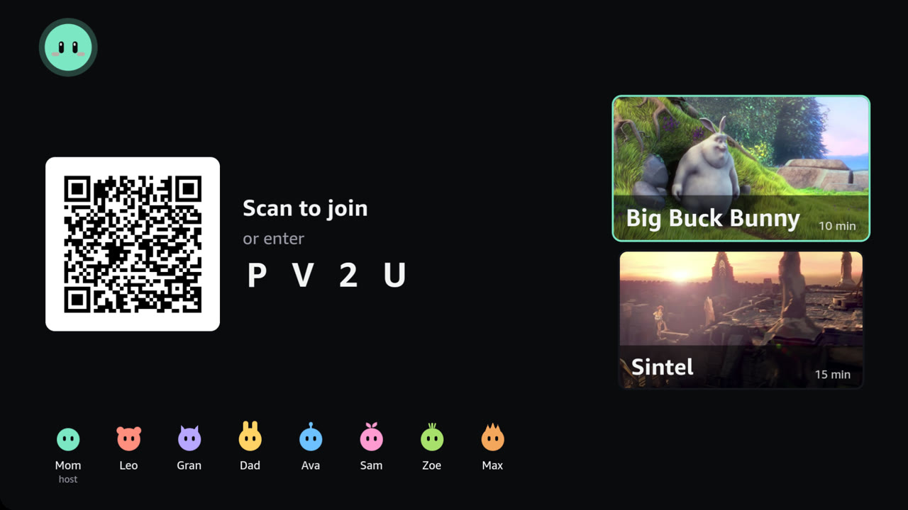
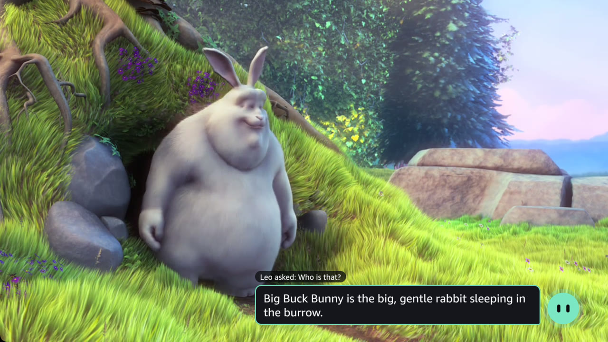
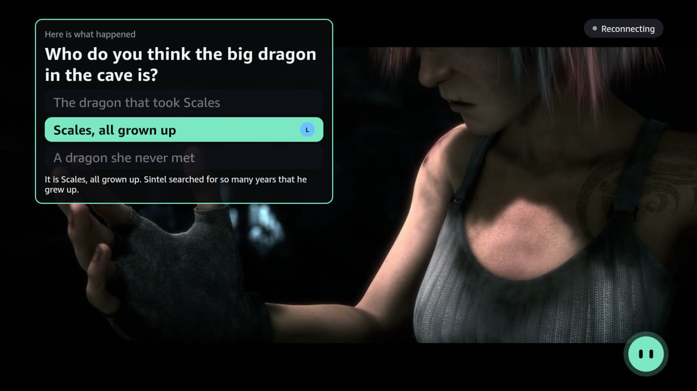
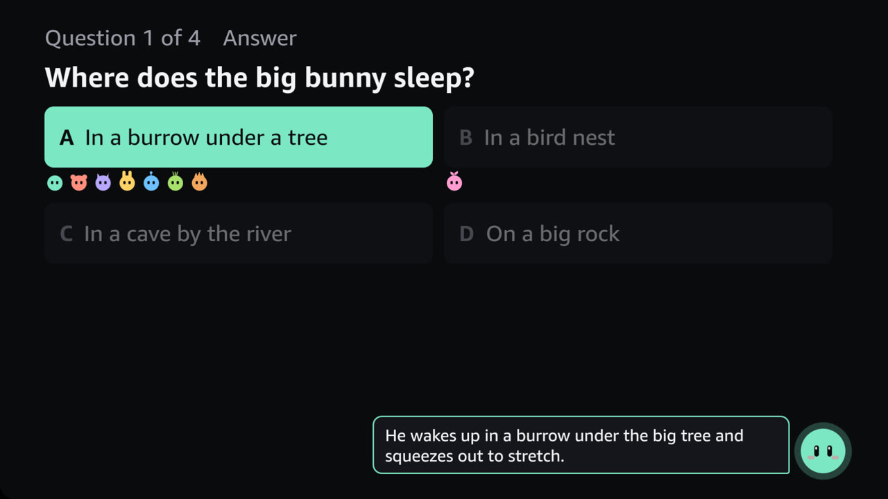
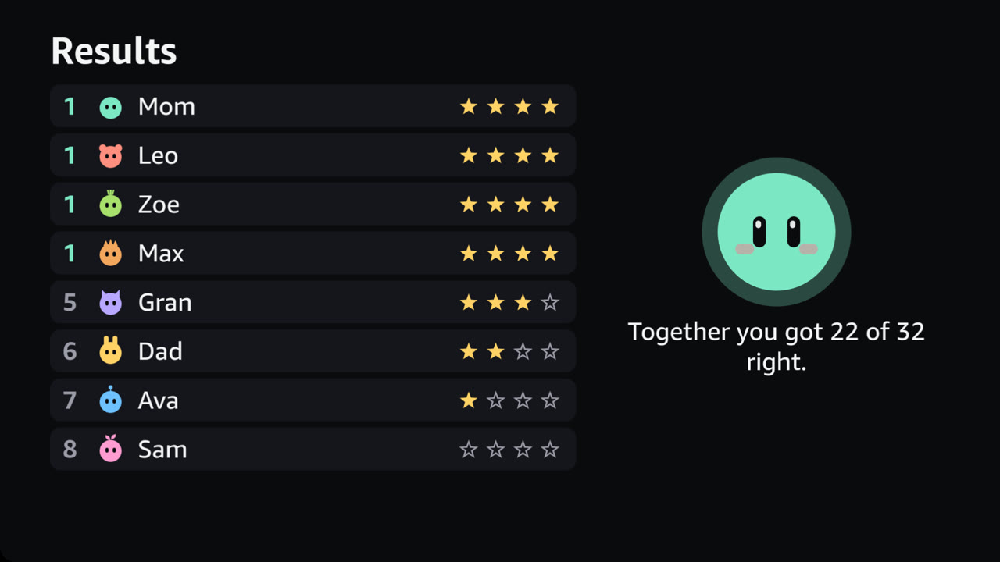
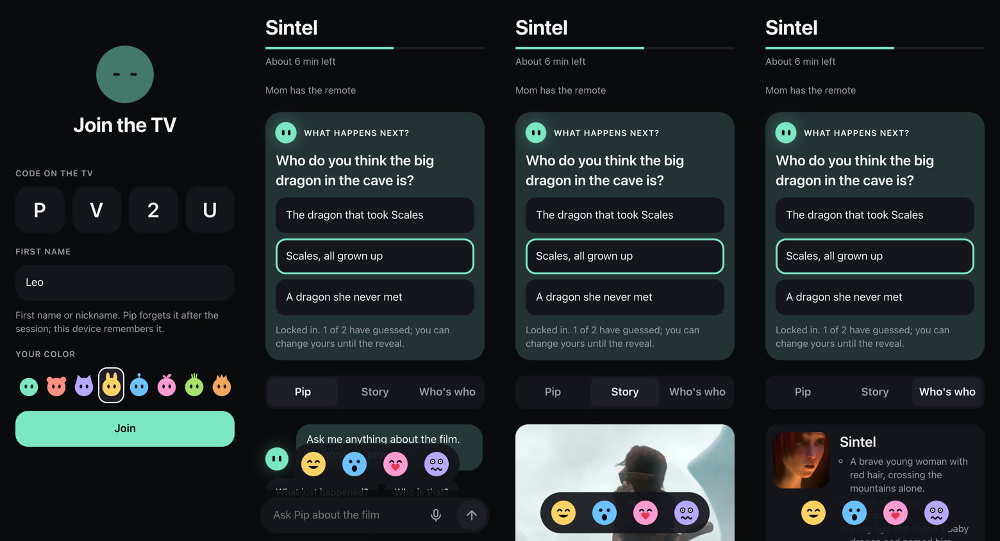

# Pip for Fire TV

Pip helps families watch, understand and play together on Fire TV. Everyone joins from their own screen, the Pip Pad replaces the remote, Pip answers questions about the film without spoilers (even when the film has a twist), and a short quiz turns the film into a game. Pip has a personality: the host picks its mood and color.

Built for the Amazon Developer Hackathon, Fire TV track. The plan, architecture, contracts and build order are in [PROJECT.md](PROJECT.md).

## Why

Most AI today lives in a chat window and works best for people who know how to prompt it. Pip is the start of a product line that puts AI on the shared screens of everyday life instead, where it understands the moment and steers the conversation for you. Pip for Fire TV is product one, on the screen almost every home already has.

Watching together on a TV is still passive. The remote is small, easy to lose, hard for children and older adults, and only one person can hold it. When a child asks "who is that?", the film stops while someone explains, or the question goes unanswered. Asking a phone means leaving the moment, knowing what to type, and risking spoilers. And when the film ends, there is nothing to do together with what you just watched.

## What it does

1. **Scan and join.** The TV shows Pip, a QR code and a 4-character code. Each person scans it and types a first name. The first one in is the host.
2. **Make Pip yours.** In the lobby the host picks Pip's mood (Chill, Playful or Sassy) and color. The mood changes how Pip talks; the color follows on the TV and every pad. Pip greets each new player by name, in that mood. Players pick a color for their avatar (their initial, like a contact photo). The default stays simple; the extras are one tap away.
3. **Watch.** The host picks a film from the posters on the Pip Pad (a tablet) and gets a remote-style Play, Pause and skip control. There are two films: Big Buck Bunny (gentle, no dialogue) and Sintel (a fantasy with a twist ending).
4. **A companion beside the film.** Each pad has three tabs: Pip (ask), Story ("Catch me up": the chapters watched so far, with pictures) and Who's who (character cards whose facts unlock as the film plays). At key moments Pip asks "What happens next?"; everyone guesses on their own pad and Pip reveals it when the film gets there, so a twist becomes a game. Anyone can tap laugh, wow, aww or scary, and the face floats up on the TV; the results name the family's favourite moment.
5. **Ask Pip.** Anyone can tap a suggested question, type or speak. Pip answers on the TV with the asker's name, using only notes about the film up to the current moment, so it does not spoil what comes next. Each answer brings two or three next questions to tap, and a vague question gets "Did you mean" options instead of a guess.
6. **Quiz.** The host starts a five-question quiz about the scenes already watched. Everyone answers on their own screen, with the same big buttons, no buzzers and no speed points.
7. **Results.** Each question ends with the right answer and a one-line explanation, then the scores and a family total: "Together you got 9 of 10 right."

## Screenshots

The TV app on the Vega Virtual Device: the lobby with eight players (each a little Pip with its own ears), Pip answering during the film, a "What happens next?" vote revealed in Sintel, a quiz reveal with everyone's picks, and the results with stars.







The Pip Pad on a phone: joining with a little-Pip avatar, a "What happens next?" vote, "Catch me up" (Story) and "Who's who".



How every Pip product behaves: AI where people already are; no AI skills needed; the interface follows the moment; together, as equals; grounded and honest; private by default (no accounts, first names only, forgotten when the session ends); and calm (Pip speaks when asked).

## What v1 proves, and what it does not claim

| Claim | Evidence |
|---|---|
| Anyone in the room can join and take part in seconds | Join times and a small usability test ([docs/measurements.md](docs/measurements.md)) |
| People get good answers without knowing how to talk to an AI | Answer quality, how often chips and "Did you mean" are used, the usability test |
| The AI stays grounded: no spoilers, and it says when it does not know | 10 spoiler probes and 5 unknown-fact probes (`npm run eval:ask`) |
| A household screen becomes a shared activity | Full quizzes with three players, and what testers said |

v1 does not claim that the Pip Pad hardware exists (it is a web app on a tablet), that Pip works over other apps (it lives inside our app), that the quiz is written live by AI (it is written ahead of time and a person checks every question; `npm run draft:quiz` drafts one with Nova), or that the speech recognition is ours (it is the browser's).

## Architecture

```text
   Pip Pads (one web app on every device)          Fire TV (Vega OS app)
 +-------------------------------------+      +-------------------------------------+
 | Host, on a tablet: pick the film,   |      | Lobby: QR code, players, films      |
 |   play, pause, skip, run the quiz   |      | W3C Media API video player          |
 | Everyone, on a phone: join with a   |      | Quiz question, reveal and results   |
 |   first name, ask Pip (type, tap    |      | Pip mascot, five states             |
 |   or speak), answer the quiz        |      | Remote and Alexa play and pause     |
 +------------------+------------------+      +------------------+------------------+
                    |  Socket.IO over HTTPS (WebSocket, with an  |
                    |  HTTP long-polling fallback), one room per |
                    |  session                                   |
                    +---------------------+----------------------+
                                          v
                   +---------------------------------------------+
                   | Pip server: one Node.js process             |
                   | Pip Core: codes, players, the host, Pip's   |
                   |   state, the guidance loop (one model call) |
                   | Film night: films, playback, quiz rules     |
                   | Express: /health, /api/films, /qr/:code,    |
                   |   /media, and the built pad app             |
                   | In-memory sessions (6 h idle expiry)        |
                   +----------------------+----------------------+
                                          | AWS SDK for JavaScript v3,
                                          | Bedrock Converse API
                                          v
                   +---------------------------------------------+
                   | Amazon Bedrock: Nova 2 Lite                 |
                   | inference profile us.amazon.nova-2-lite-v1:0|
                   +---------------------------------------------+
```

**Pip's brain.** Ask Pip calls Nova 2 Lite on Bedrock. While the AWS account was being verified, the same code ran on a free local model through Ollama (`AI_PROVIDER=ollama`, `qwen2.5:3b`), with a simpler prompt that never asks "Did you mean"; the demo uses Nova. Every good answer goes into an **answer memory** per film and scene: the same question at the same scene is answered at once, and if the model fails Pip answers with the closest earlier question, never from a scene the family has not reached.

The server owns everything: the stage, the host, the quiz timing and the scores. After every change it sends each screen the whole session as one snapshot, so a screen that reconnects needs no catch-up logic, and every command is built so a repeated tap does no harm. The TV and the pads only draw what they are sent. Nothing calls Bedrock except the server.

### Pip Core and the film activity

Pip is meant to become a product line, so the server keeps what any Pip product needs apart from what is only about films: two folders and one import rule, checked by a test.

| Pip Core: `server/src/core/` | Film night: `server/src/film/` |
|---|---|
| Pairing codes, and the code a reconnecting TV gets back | Film files: details, notes and the quiz |
| Players: names, joining, leaving, the host and its hand-over | The playback position estimate |
| Pip's five states and their timers | The Ask Pip prompt, built only from what the family has seen |
| The guidance loop: one model call, the answer with next questions or "Did you mean" options, cleaning and fallbacks | The quiz rules: unlock, answer, reveal, score, standings |
| Keyed timers and the join limit | The quiz draft prompt and its checks |

`core/` never imports from `film/`. The next Pip product reuses the join flow, Pip's states, the guidance loop, the pad's shell and the contract pattern unchanged.

## Amazon technologies

| Technology | How Pip uses it |
|---|---|
| Vega OS and the Vega SDK (React Native for Vega) | The TV app |
| Vega Virtual Device or a Vega-based Fire TV device | Where the TV app runs |
| W3C Media API (`@amazon-devices/react-native-w3cmedia`) | Plays the film, MP4 in URL mode, from our own server |
| Vega Media Controls | Play and pause from the remote, and Alexa voice on a real device |
| Amazon Bedrock, Nova 2 Lite (Converse API) | Ask Pip, live, and the quiz drafts before the demo |
| Vega focus management (`FocusManager`, `hasTVPreferredFocus`) | The film posters on the TV can be picked with the remote |
| Amazon Devices Builder Tools (MCP) | The coding agent read the Vega guides through it (media player, focus, remote buttons, RN 0.83 layout in dp) and used `inputd-cli` to press the remote's buttons in tests |
| Fire HD tablet | Runs the host's Pip Pad |

## How to run it

Node 22 is required (`.nvmrc`). Each package has its own README:

- [server/README.md](server/README.md): the Pip server, its environment variables, and the smoke and eval scripts.
- [pad/README.md](pad/README.md): the Pip Pad web app.
- [tv/README.md](tv/README.md): the Vega TV app, the commands that worked, and what we learned about Vega.

For the full loop on a Mac: `npm run tunnel` at the root (writes the HTTPS URL into `server/.env` and the TV config), then `npm run build` in `pad/`, `npm start` in `server/`, and the TV app on the VVD or a device (rebuild it after a new tunnel URL). Then scan the QR code on the TV. Without AWS, set `AI_PROVIDER=ollama` in `server/.env` and run `ollama pull qwen2.5:3b` first. Before a rehearsal or a recording, `npm run preflight` checks the whole setup and prints PASS or FAIL for each part.

At the root, `npm run typecheck`, `npm run lint` and `npm test` run in every package; `npm run sync:shared` copies the one shared contract, `shared/protocol.ts`, into each package.

## Tests and measurements

- Unit tests with Vitest for every rule: joining, the host hand-over, the quiz, scoring and standings, reply parsing, prompt building, the pad's reducer and helpers (`npm test`).
- Smoke scripts over real sockets: `smoke:join` and `smoke:quiz` in `server/`; `smoke:ai` makes one real model call; `eval:ask` runs the grounding probes (`-- sintel` for the second film).
- On the Vega Virtual Device: scripted players joined, controlled the film, asked Pip and played whole quizzes against the real TV app, and the server was restarted mid-film.
- Every failure in PROJECT.md section 4.10 was walked through in browsers against the real server.
- Real numbers from the demo setup (latency, answer quality, grounding probes, guidance use, quiz runs and the usability test) are in [docs/measurements.md](docs/measurements.md).

## Known issues

Found while walking through every failure in PROJECT.md section 4.10 (Step 10). Each one recovers by itself.

- After a server restart, a pad that reconnects before the TV shows "Looking for your TV" until its next try, up to 10 s later. The 10 s retry (PROJECT.md 4.5) keeps a family of 8 on one home address under the join limit.
- If the host leaves and comes back last, the first player back gets the host controls only when the host's 10 s grace has run out.
- iPhone Safari has no full-screen mode for web pages, so there the pad keeps the browser bars. Added to the home screen, it opens without them.
- Pressing Home on the TV remote closes the Vega app; opened again, it gets a new code and the pads scan again (stretch goal S7 would keep the code).
- A skip takes 1.1 to 1.6 s to land, while the TV's player re-buffers over the tunnel.
- The local model (`AI_PROVIDER=ollama`) never leaked a spoiler in the probes, but it sometimes makes up small facts and barely changes its tone between moods. It is for rehearsals; the demo uses Nova.

## Credits and licenses

- Code: MIT, see [LICENSE](LICENSE).
- Big Buck Bunny, (c) copyright 2008 Blender Foundation, www.bigbuckbunny.org, CC BY 3.0.
- Sintel, (c) copyright 2010 Blender Foundation, durian.blender.org, CC BY 3.0.
- The films are served from our own server and are not in this repository. The posters and screenshots are stills from them.
