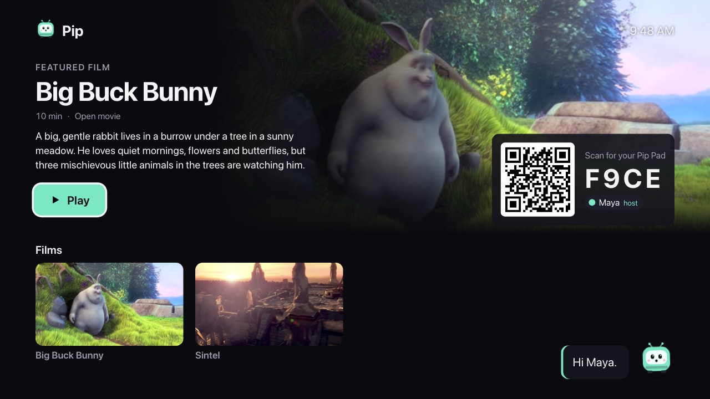
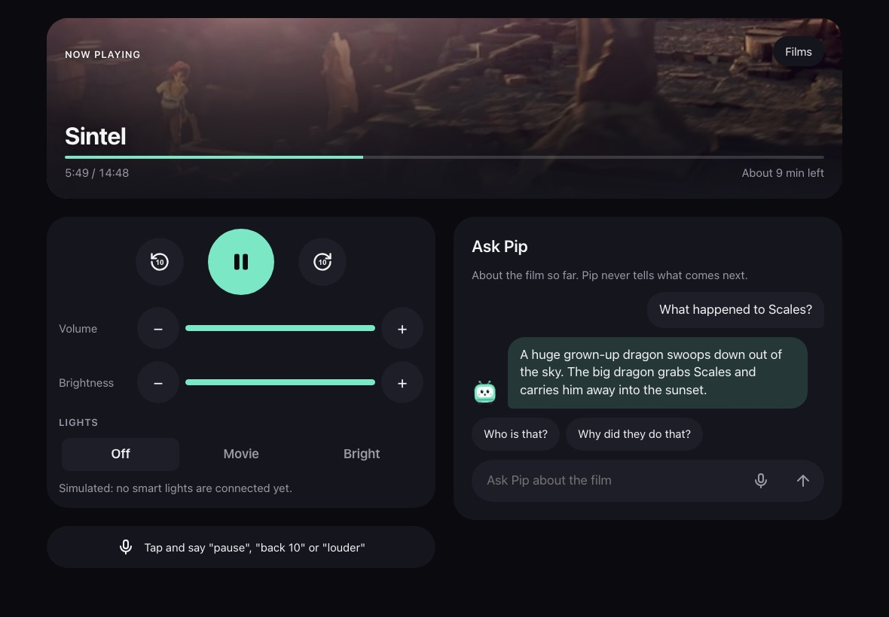
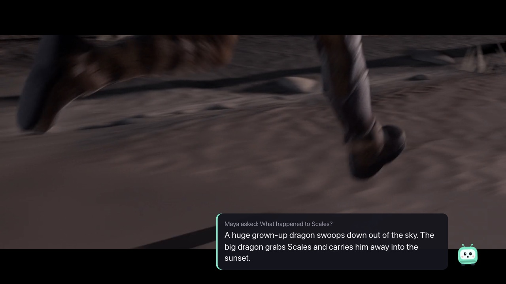
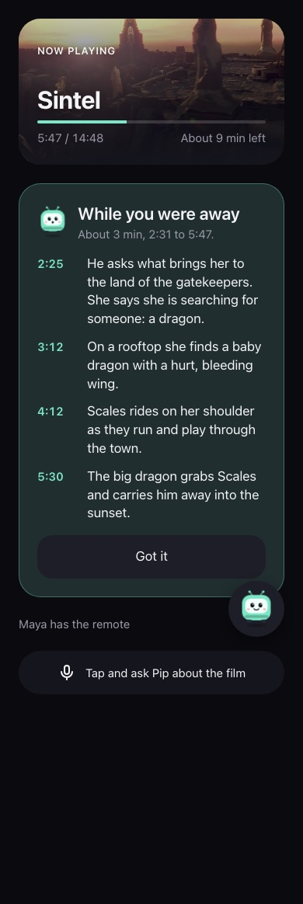

# Pip for Fire TV

Pip is a quiet film companion for Fire TV. It knows the film only up to the second the family has reached, so it can answer "who is that?" or "what did I miss?" without spoiling what comes next. It stays hidden until someone asks, and everything runs on your own machine.

Built for the Amazon Developer Hackathon, Fire TV track. Direction: [docs/vnext/PLAN.md](docs/vnext/PLAN.md) (section 0: local-first since 22 Oct). Infrastructure reference: [PROJECT.md](PROJECT.md). What exists now: [docs/architecture/current-state.md](docs/architecture/current-state.md).

## What it does

1. **Join.** The TV shows a QR code and a 4-character code. Each person scans it with a phone or tablet (the Pip Pad) and types a first name. The first one in is the host.
2. **Watch.** The host picks Big Buck Bunny or Sintel. During the film Pip is invisible on the TV.
3. **Control it any way you like.** Play, pause, ±10 s, volume, brightness and simulated lights come from the host's pad, voice ("pause", "back 10", "louder"), webcam hand gestures (`npm run gesture`) or the TV remote. They all go through one action router, and the TV confirms each command. None of them calls a model.
4. **Ask Pip.** Tap, type or speak. Pip answers briefly on the TV and the asker's pad, using only facts the film has already shown. Questions about later get "No spoilers from me".
5. **While you were away.** A pad that sleeps or drops off during the film, or someone who joins late, gets a private recap of what they missed, up to now and never further. The film keeps playing for everyone else.
6. **What if...?** "What if Sintel had kept Scales inside that night?" or, after the film, "Give it a happier ending." Pip makes up a short version of the story from what has been shown so far, labelled "made up by Pip" on every screen. Mid-film it doesn't know the real story ahead, and the spoiler gate keeps later words and unseen characters out, so a made-up ending can't give the real one away by accident. Both films are CC BY 3.0, which allows adaptations.
7. **Kids games (opt-in).** A switch in the lobby turns on guesses, reactions and a quiz after the film. They're off by default.







The TV screenshots are from the browser TV at `/tv`. The Vega app's earlier screens (16 Oct, on the Vega Virtual Device) are in `docs/screenshots/tv-*.jpg`.

## What is measured, and what is not claimed

| Claim | Evidence |
|---|---|
| Pip does not spoil the film | 0 leaks in 104 probes on Big Buck Bunny and 110 on Sintel with the local model (`npm run eval -- <film> --ollama`; [docs/evaluation/results/](docs/evaluation/results/)) |
| Pip answers when the film has shown the answer | 98% (Big Buck Bunny) and 95% (Sintel) of grounded questions answered; every expected fact cited |
| Pip says when it doesn't know | Abstains correctly on 93 to 95% of unknown-fact and future questions |
| Controls never wait for a model | 0 model calls for playback; TV confirmation in 6 to 12 ms (browser TV), 177 to 239 ms (VVD over the tunnel) |
| The catch-up is private and safe | Lab scenarios over real sockets (`server/src/lab/away.test.ts`) |

Not claimed: that the Pip Pad hardware exists (it's a web app; the touch-wheel input contract and simulator exist), that Pip works over other apps (it lives inside our app), that the speech recognition is ours (it's the browser's), or anything measured on Nova (AWS was not available).

## Architecture

```text
 Pip Pads (web app: phones, tablets)   Webcam gestures     Fire TV (Vega app) or /tv (browser)
          |   pad:input, pad:ask,             |  pad:input     |  tv:playback, tv:applied
          |   pad:away                        |                |
          +---------------+-------------------+----------------+
                          | Socket.IO, one room per session, protocol v8 (shared/protocol.ts)
                          v
   +--------------------------------------------------------------------------+
   | Pip server (Node.js 22)                                                  |
   | actions.ts: one router for every input -> tv:command -> TV confirms      |
   | answer.ts: spoiler boundary -> retrieval -> (model) -> answer gate       |
   | away.ts: "While you were away" from the same boundary, no model          |
   | journal: pseudonymous events, never names or question text               |
   +--------------------------------------+-----------------------------------+
                                          | HTTP, localhost
                                          v
   +--------------------------------------------------------------------------+
   | Ollama on the same machine: qwen2.5:3b (answers)                         |
   | Offline pipeline: ffmpeg, whisper.cpp, qwen3-vl:4b-instruct -> timelines |
   +--------------------------------------------------------------------------+
```

**Timelines.** Each film has `server/content/timelines/<id>.json`: timed facts with evidence (a frame or a line of dialogue), a review status, the second each is revealed, and the words it reveals first. The server answers only from accepted facts revealed by the current position. For the demo films, the facts come from their notes, each checked against a frame (`npm run timeline:notes`). The video pipeline (`npm run pipeline`) can draft them from the film itself. See [docs/architecture/video-data-pipeline.md](docs/architecture/video-data-pipeline.md).

**The brain.** `AI_PROVIDER=ollama` (the default) uses `qwen2.5:3b`, which is free, offline and private. `AI_PROVIDER=bedrock` uses Nova 2 Lite on Amazon Bedrock through the same interface. That path has not been verified, because the AWS account wasn't ready.

**Pip Core and the film activity.** `server/src/core/` (pairing, players, Pip's states, the spoiler boundary, retrieval, the catch-up, intents, the journal) never imports from `server/src/film/` (film files, the quiz, the companion). A test enforces the split, so the next Pip product reuses the core.

## Amazon technologies

| Technology | How Pip uses it |
|---|---|
| Vega OS, Vega SDK 0.24, React Native for Vega 0.83 | The TV app |
| Vega Virtual Device | Where the TV app ran in development |
| W3C Media API (`@amazon-devices/react-native-w3cmedia`) | Plays the film, MP4 in URL mode, from our own server |
| Vega Media Controls | Play and pause from the remote |
| Vega focus management (`FocusManager`) | Picking a film with the remote |
| Amazon Devices Builder Tools (MCP) | The coding agent read the Vega guides through it and pressed the remote's buttons with `inputd-cli` in tests |
| Amazon Bedrock, Nova 2 Lite | Optional adapter, not verified (no AWS account in time) |

## How to run it

Node 22 is required (`.nvmrc`). One-time setup: `ollama pull qwen2.5:3b`, and the films in `server/media/` (PROJECT.md 5.6).

```bash
npm run tunnel                      # HTTPS URL into server/.env and tv/src/config.ts; keep it running
cd pad && npm run build             # the Pip Pad and the browser TV
cd server && npm start              # then open http://localhost:8787/tv and scan the QR code
cd server && npm run gesture -- CODE --preview   # optional: webcam gestures (gesture/README.md)
npm run preflight                   # PASS or FAIL for every part, before a rehearsal or recording
```

The Vega app: [tv/README.md](tv/README.md). Rebuild it after a new tunnel URL. The other package READMEs are [server/README.md](server/README.md) and [pad/README.md](pad/README.md).

## Tests

- `npm test` at the root: 388 server tests (Vitest), the pad's tests and the TV's tests.
- `cd server && npm run lab`: the Virtual Pip Lab, the real server over real sockets with a fake TV and fake pads, including faults and "While you were away".
- `cd server && npm run eval -- <film> [--ollama]`: the benchmark (spoiler probes, grounded questions, unknown facts, routing) on the film's timeline.
- `npm run check:shared`, `npm run typecheck`, `npm run lint`.

## Known issues

- The local 3B model still guesses small things it was not told (for example, "the nut is the chinchilla's favourite food"). The answer gate stops it from naming anything the film hasn't shown yet, but not from inferring from what has been shown.
- A few grounded questions right after a new moment ("Who is the little dragon?" at 9:40) still get "I'm not sure" when the model's wording is withheld and no single fact matches the question's words.
- The vNext build has been walked through on the browser TV. The Vega app was checked on the VVD on 16 Oct, but not yet with the merged server and protocol v8.
- After a server restart, a pad can show "Looking for your TV" for up to 10 s.
- iPhone Safari has no full screen for web pages; added to the home screen, the pad opens without browser bars.
- A skip takes 1.1 to 1.6 s to land on the Vega app while the player re-buffers over the tunnel.

## Credits and licenses

- Code: MIT, see [LICENSE](LICENSE). Vendored: gesture-tv-remote (MIT) in `gesture/vendor`.
- Big Buck Bunny, (c) copyright 2008 Blender Foundation, www.bigbuckbunny.org, CC BY 3.0.
- Sintel, (c) copyright 2010 Blender Foundation, durian.blender.org, CC BY 3.0.
- The films are served from our own server and are not in this repository. The posters and screenshots are stills from them.
