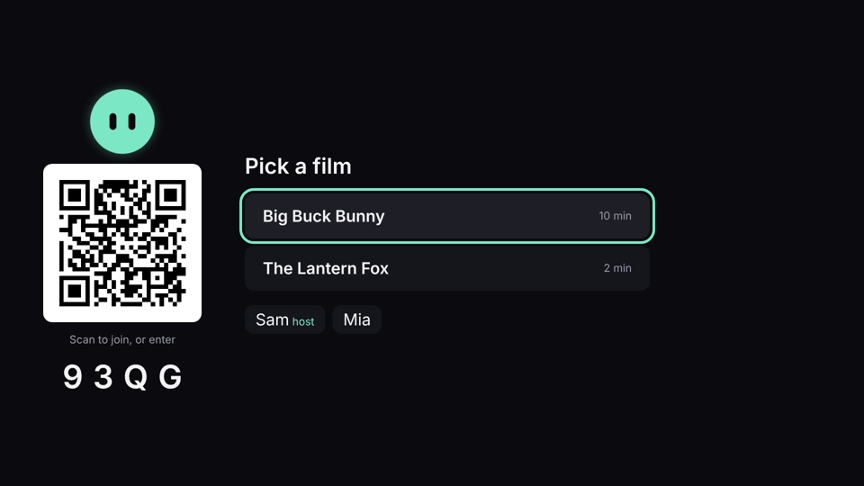
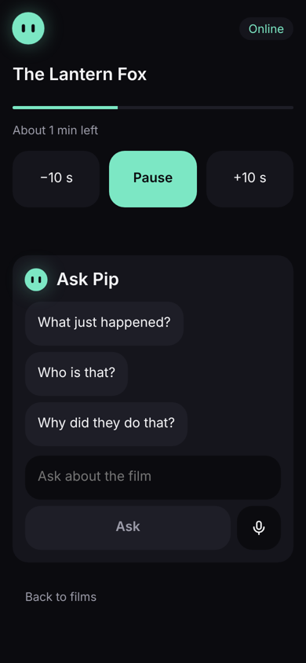
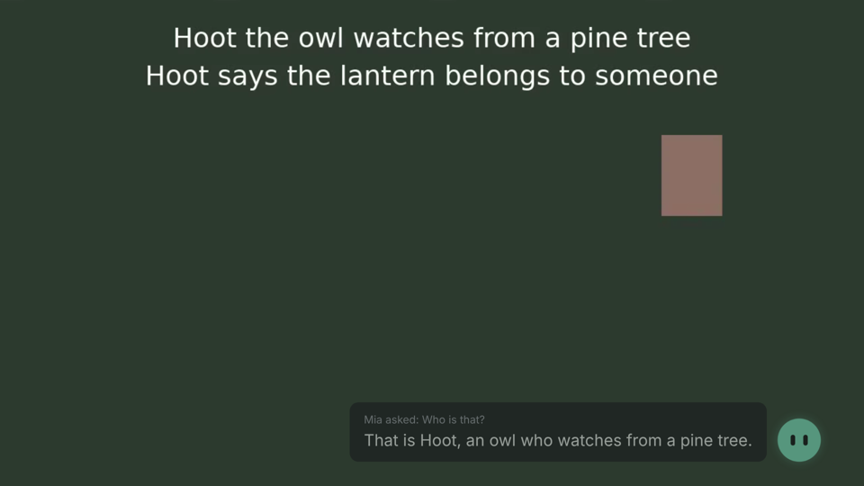

# Pip for Fire TV

Pip helps a household watch together. Everyone joins from their own phone or a tablet (the Pip Pad); the film stays full screen on the TV; anyone can ask Pip about what is on screen and gets a short answer drawn only from what the room has already seen, or an honest "not sure"; the host controls playback, and Pip says "Paused" only once the TV has actually paused.

Pip is the first product of a context-and-action system: understand the moment, answer from what is established, act through permitted devices, verify the result. See [PRODUCT.md](PRODUCT.md).

Status: in development for the Amazon Developer Hackathon (Fire TV track). The server, the Pip Pad, a browser TV simulator, the video data pipeline and the benchmark are built and tested. The Vega TV app is not started (it is generated on a Mac with the Vega SDK). Plan and status: [PROJECT.md](PROJECT.md), section 0.4.

| TV (simulator) | Pip Pad (host) | Pip answers |
|---|---|---|
|  |  |  |

## What makes it different

- **Quiet by default.** During the film the TV shows only the film. Pip appears when asked and leaves after a few seconds or a tap on Done.
- **Spoiler-safe in code, not just in a prompt.** Answers come from reviewed, timestamped facts revealed by the current playback position. The model is never asked without evidence, and every reply passes an answer gate that blocks later names and spoiler words and checks citations. On the lab benchmark: 0 leaks in 68 probe runs, even with a fake model that always tells the ending.
- **Done means observed.** Commands carry ids, repeats are ignored, and the pad shows a result only when the TV's own report confirms it.
- **One input path.** Pad buttons, a touchwheel (simulated today) and remote keys all become the same intents on the server.

## How it fits together

```text
 Pip Pads (web, phones and tablet)        Fire TV (Vega app, or pad/tv.html simulator)
            \                                  /
             \---- Socket.IO, protocol v3 ----/
                           |
            Pip server (one Node.js process)
   router -> spoiler boundary -> retrieval -> (model) -> answer gate
   tracked commands <- TV playback reports     session journal
                           |
             Amazon Bedrock, Nova 2 Lite (optional)

 Offline: film -> pipeline (scenes, frames, candidates, review) -> timeline -> dataset -> benchmark
```

Architecture: [docs/architecture/target-architecture.md](docs/architecture/target-architecture.md). Verified current state: [docs/architecture/current-state.md](docs/architecture/current-state.md). Decisions: [docs/decisions/](docs/decisions/).

## Run it

Node 22 (`.nvmrc`) and ffmpeg. From the repo root:

```bash
cd server && cp .env.example .env && npm install && cd ..
cd pad && npm install && npm run build && cd ..

# The lab: our own test film, no Fire TV, no AWS needed
cd server
npm run lab:film                        # renders media/lantern-fox.mp4 (+ .webm for browsers)
LAB_CONTENT=true AI_ENABLED=false npm start
```

Then open `http://localhost:8787/tv.html` (the TV simulator; keyboard: Space play or pause, arrows seek, Esc hides Pip) and `http://localhost:8787/?code=<code on the TV>` on a phone or another window (add `&lab=1` for the simulated Pip button and touchwheel). Pick "The Lantern Fox", scrub on the TV, and ask "Who is that?" or "What happens next?".

For the real film and model: put Big Buck Bunny in `server/media/` (PROJECT.md 5.6), build its timeline with the pipeline ([docs/architecture/video-data-pipeline.md](docs/architecture/video-data-pipeline.md)), set up the AWS profile (PROJECT.md 9.3), and start with `AI_ENABLED=true`. Package details: [server/README.md](server/README.md), [pad/README.md](pad/README.md).

## Test and measure

```bash
npm run check:shared && npm run typecheck && npm run lint && npm test   # root: both packages
cd server && npm run lab      # Virtual Pip Lab: real sockets, fault injection
cd server && npm run eval     # spoiler, abstention, grounding and routing benchmark
node scripts/e2e-browser.mjs http://localhost:8787 /tmp/shots   # browser run (needs Playwright)
```

Results and protocol: [docs/evaluation/README.md](docs/evaluation/README.md).

## Known limits

- No Vega app yet; the TV experience is shown with the browser simulator, which is not proof of Fire TV support.
- No reviewed Big Buck Bunny timeline yet, so Pip says it has no notes for that film. The download host was blocked in the cloud environment used to build this.
- No real-model (Nova) measurements yet; the benchmark's model numbers come from fake models that test the plumbing, not answer quality.
- The Pip button and touchwheel are simulated; no hardware has been connected.
- Sessions live in memory; a server restart keeps the film playing but forgets scores and history (PROJECT.md 4.10).

## Roadmap

1. Big Buck Bunny timeline, reviewed (pipeline on the Mac).
2. The Vega TV app on protocol v3 (PROJECT.md Steps 3 and 6).
3. Real Nova measurements and the usability test (PROJECT.md 14.3, 14.4).
4. Later: a transparent recommendation loop, a physical Pip Pad input board, and only then any persistent, consented memory.

## Credits and licences

- Code: MIT ([LICENSE](LICENSE)).
- Big Buck Bunny, (c) copyright 2008 Blender Foundation, www.bigbuckbunny.org, CC BY 3.0.
- The Lantern Fox: an original test film and story by this project (MIT), rendered with ffmpeg.
- Tools reviewed or used, with licences: [docs/engineering/open-source-adoption.md](docs/engineering/open-source-adoption.md).
