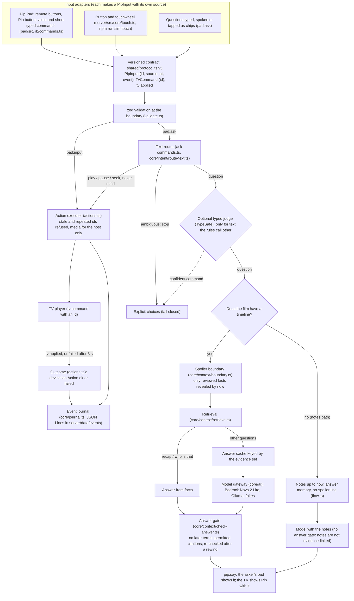
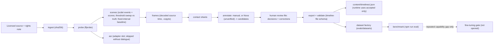

# Target architecture

Where Pip is going, and which parts already exist. Status words: **built** (code and tests in this repo), **partial**, **planned**. Verified facts about the current build are in [current-state.md](current-state.md).

Pip is one context-and-action loop: inputs become semantic events; the server keeps session state and a journal; questions are answered from time-bounded evidence before any model is asked; actions run only through an allowlisted executor and count only when the device confirms them; everything is logged so an offline data factory can improve the timeline and the benchmark.

## Runtime loop

As merged on 17 Oct 2026 (the cloud branch's vNext work onto `mac/film-and-tv`; protocol v5).

## Modules and status

| Responsibility | Where | Status |
|---|---|---|
| Input adapters | `pad/src/lib/commands.ts` (voice and typed), `server/src/core/touch.ts` (button and touchwheel readings), `npm run sim:touch` | **Built**; hardware simulated; the TV remote is not an input adapter yet |
| Event contract, versioned | `shared/protocol.ts` (`PROTOCOL_VERSION = 5`), zod in `server/src/validate.ts` | **Built** |
| Event journal and session state | `server/src/core/journal.ts` (JSON Lines on disk, pseudonymous ids, consent scope), `server/src/sessions.ts` | **Built** |
| Idempotency | input `id` (`seenInputIds` in `actions.ts`), `TvCommand.id` | **Built** |
| Content timeline (facts, entities, evidence, review) | `server/src/core/context/timeline.ts`, `server/src/film/timeline-file.ts` | **Built**; only the lab film has a timeline so far |
| Memory: events, content, answers, datasets kept apart | Journal (events), timelines (content), answer memory (notes path) and the evidence-keyed answer cache (timeline path), `evals/datasets` | **Partial**: no preference memory, on purpose (needs consent first) |
| Retrieval, time-bounded | `server/src/core/context/retrieve.ts` | **Built**, keyword and entity; no embeddings (not needed by the benchmark yet) |
| Decision router | `server/src/core/intent/route-text.ts`, `server/src/ask-commands.ts`, `server/src/flow.ts` | **Built** |
| Typed semantic judgement | `server/src/core/intent/judge.ts`, `server/src/typesafe-judge.ts` | **Partial**: adapter and policy built; not run against the live API (paid) |
| Model gateway | `server/src/core/ai/` (`TextModel`: Bedrock, Ollama, fake; timeouts; never throws) | **Built**; Nova not run yet (AWS pending) |
| Action executor with outcome check | `server/src/actions.ts` (the TV confirms each command with `tv:applied`) | **Built**; 73 to 120 ms on the VVD |
| Answer validation | `server/src/core/context/check-answer.ts`, `server/src/answer.ts` | **Built** for films with a timeline; the notes path has the no-spoiler line only |
| Outcome and feedback records | Journal events (`action.requested`, `action.confirmed`, `action.failed`, `input.refused`) | **Partial**: no explicit "that was wrong" feedback from people yet |
| Video data pipeline | `server/scripts/pipeline.ts`, `server/src/pipeline/`; `server/scripts/annotate.ts` (local VLM candidates through Ollama) | **Built**; lab film run; Big Buck Bunny and Sintel not run yet (Mac) |
| Evaluation | `server/scripts/eval.ts`, `server/src/eval/`, `server/evals/` | **Built**; measured with the local model (`--ollama`); `--nova` pending |
| Virtual Pip Lab | `server/src/lab/` (20 real-socket scenarios with faults), `scripts/fake-tv.ts`, `smoke:join`, `sim:touch` | **Built**; the cloud's browser TV simulator was not merged (the Vega app is the TV) |
| TV app | `tv/` (React Native for Vega) | **Built**; checked on the Vega Virtual Device |
| Recommendations | none | **Planned** (section below) |

Process shape stays one Node process with in-memory sessions, as PROJECT.md decided for v1. Nothing here needs a second service.

## The spoiler boundary, exactly

This applies to films with a timeline (today the lab film). Films without one (Big Buck Bunny and Sintel) use the notes path: notes up to the position, the prompt's rules and the fixed no-spoiler line for questions about the future, but no answer gate, because their notes are not evidence-linked. Building their timelines with the pipeline is the next step.

1. `boundarySec` is the playback position estimated from the TV's latest report (`film/playback.ts`). It moves back on a rewind.
2. A fact is permitted when `revealSec <= boundarySec` and its review state is usable (`accepted` by default; `TIMELINE_REVIEW=candidate` for development only).
3. Restricted terms are the names and aliases of entities not yet seen plus the spoiler terms of facts not yet revealed (rejected facts included), minus any term already present in revealed text.
4. Before any model call: no timeline, no permitted facts, a question about the future, or a question containing a restricted term each end in a fixed line. The model is never asked without evidence, because its own knowledge of a famous film could spoil it.
5. After the model: the answer gate rejects a reply that contains a restricted term (whole words and simple endings), cites a fact that is not permitted, or names something from the content without citing anything. Unsafe "Did you mean" options and next chips are dropped.
6. On delivery, if the film was rewound while the model was thinking, the answer is checked again at the new position.
7. The answer cache key includes the exact permitted evidence set, the prompt version and the model id, so an answer made from later evidence can never be served after a rewind.

## Offline data factory

Details and commands: [video-data-pipeline.md](video-data-pipeline.md). Benchmark protocol: [../evaluation/README.md](../evaluation/README.md).

## Recommendations (planned, not built)

A transparent loop, no learned recommender without data: explicit intent ("something funny, 25 minutes, with the kids"), hard constraints (catalogue, time, suitability the person chose), candidates from known metadata, a simple weighted ranker (a typed judgement only if it beats the baseline on a benchmark), two or three results with one-line reasons and correction chips ("shorter", "less intense", "not this"), and separate records for impression, selection, explicit feedback and completion. Mood is only what people say, never inferred from behaviour; no sensitive traits are ever inferred.

## What stays out

No microservices, no general agent framework, no vector database, no persistent personal memory, no fine-tuning, and no 3D simulator, until a measured need appears. See [../decisions/](../decisions/).
