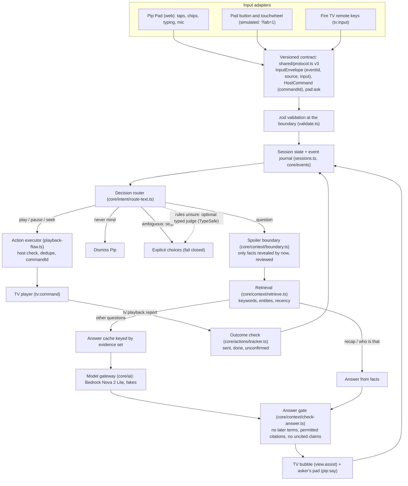
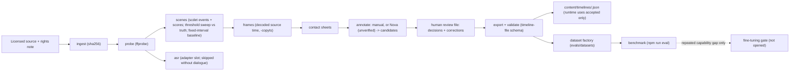

# Target architecture

Where Pip is going, and which parts already exist. Status words: **built** (code and tests in this repo), **partial**, **planned**. Verified facts about the current build are in [current-state.md](current-state.md).

Pip is one context-and-action loop: inputs become semantic events; the server keeps session state and a journal; questions are answered from time-bounded evidence before any model is asked; actions run only through an allowlisted executor and count only when the device confirms them; everything is logged so an offline data factory can improve the timeline and the benchmark.

## Runtime loop

## Modules and status

| Responsibility | Where | Status |
|---|---|---|
| Input adapters (remote keys, button gestures, wheel detents to intents) | `server/src/core/input/adapters.ts`; pad lab panel; TV simulator keys | **Built** (hardware is simulated) |
| Event contract, versioned | `shared/protocol.ts` (`PROTOCOL_VERSION = 3`), zod in `server/src/validate.ts` | **Built** |
| Event journal and session state | `server/src/core/events/journal.ts`, `server/src/sessions.ts` | **Built**, in memory, bounded; JSON Lines export function, no disk sink |
| Idempotency | `server/src/core/input/dedupe.ts`; `commandId` and `eventId` | **Built** |
| Content timeline (facts, entities, evidence, review) | `server/src/core/context/timeline.ts`, `server/src/film/timeline-file.ts` | **Built** |
| Memory: events, content, preferences, datasets kept apart | Journal (events), timelines (content), `evals/datasets` (datasets) | **Partial**: no preference memory, on purpose (needs consent first) |
| Retrieval, time-bounded | `server/src/core/context/retrieve.ts` | **Built**, keyword and entity; no embeddings (not needed by the benchmark yet) |
| Decision router | `server/src/core/intent/route-text.ts`, `server/src/assist-flow.ts` | **Built** |
| Typed semantic judgement | `server/src/core/intent/judge.ts`, `server/src/typesafe-judge.ts` | **Partial**: adapter and policy built; not run against the live API |
| Model gateway | `server/src/core/ai/` (`TextModel`, Bedrock, fake, timeouts, never throws) | **Built**; local model adapter (Ollama) **planned** only if needed |
| Action executor with outcome check | `server/src/playback-flow.ts`, `server/src/core/actions/tracker.ts` | **Built** |
| Answer and action validation | `server/src/core/context/check-answer.ts`, `server/src/answer.ts` | **Built** |
| Outcome and feedback records | Journal events (`action.done`, `action.unconfirmed`, `ask.reply`) | **Partial**: no explicit "that was wrong" feedback from people yet |
| Video data pipeline | `server/scripts/pipeline.ts`, `server/src/pipeline/` | **Built**; Big Buck Bunny run **blocked here** (media host blocked) |
| Evaluation | `server/scripts/eval.ts`, `server/src/eval/`, `server/evals/` | **Built** |
| Virtual Pip Lab | `server/src/lab/` (real-socket scenarios), `pad/tv.html` (TV simulator), `scripts/e2e-browser.mjs` | **Built** |
| Recommendations | none | **Planned** (section below) |

Process shape stays one Node process with in-memory sessions, as PROJECT.md decided for v1. Nothing here needs a second service.

## The spoiler boundary, exactly

1. `boundarySec` is the playback position estimated from the TV's latest report (`film/playback.ts`). It moves back on a rewind.
2. A fact is permitted when `revealSec <= boundarySec` and its review state is usable (`accepted` by default; `TIMELINE_REVIEW=candidate` for development only).
3. Restricted terms are the names and aliases of entities not yet seen plus the spoiler terms of facts not yet revealed (rejected facts included), minus any term already present in revealed text.
4. Before any model call: no timeline, no permitted facts, a question about the future, or a question containing a restricted term each end in a fixed line. The model is never asked without evidence, because its own knowledge of a famous film could spoil it.
5. After the model: the answer gate rejects a reply that contains a restricted term (whole words and simple endings), cites a fact that is not permitted, or names something from the content without citing anything. Unsafe "Did you mean" options and next chips are dropped.
6. On delivery, if the film was rewound while the model was thinking, the answer is checked again at the new position.
7. The answer cache key includes the exact permitted evidence set, the prompt version and the model id, so an answer made from later evidence can never be served after a rewind.

## Offline data factory

Details and commands: [video-data-pipeline.md](video-data-pipeline.md). Benchmark protocol: [../evaluation/README.md](../evaluation/README.md).

## Recommendations (planned, not built)

A transparent loop, no learned recommender without data: explicit intent ("something funny, 25 minutes, with the kids"), hard constraints (catalogue, time, suitability the person chose), candidates from known metadata, a simple weighted ranker (a typed judgement only if it beats the baseline on a benchmark), two or three results with one-line reasons and correction chips ("shorter", "less intense", "not this"), and separate records for impression, selection, explicit feedback and completion. Mood is only what people say, never inferred from behaviour; no sensitive traits are ever inferred.

## What stays out

No microservices, no general agent framework, no vector database, no persistent personal memory, no fine-tuning, and no 3D simulator, until a measured need appears. See [../decisions/](../decisions/).
